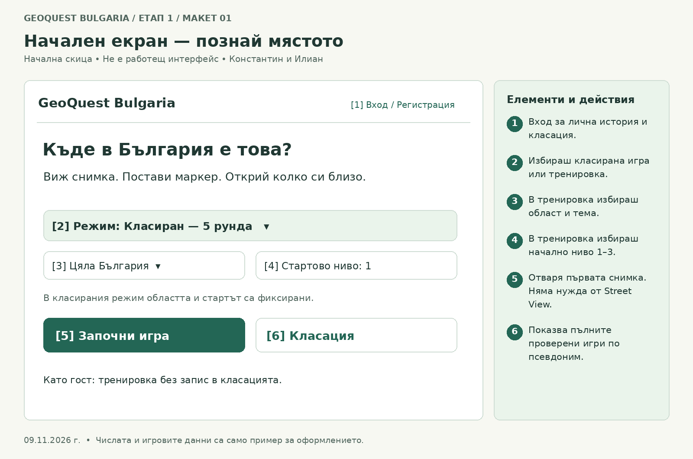
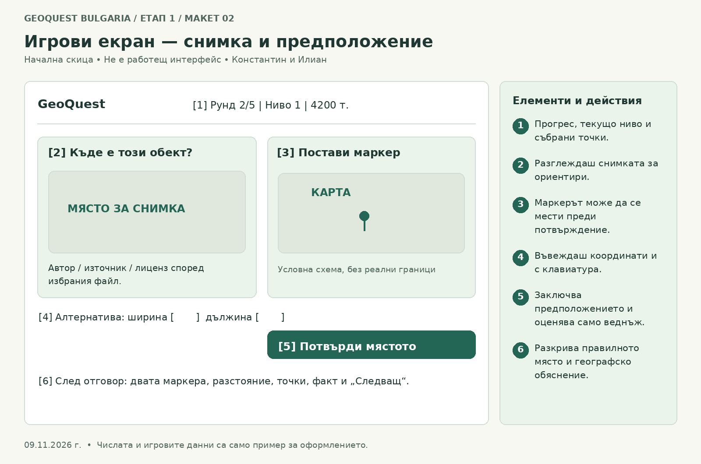

# Начални екрани — игра по снимки

Статични схеми, не работещ интерфейс. Няма реална снимка или географска карта.

## Екран 1 — начало

1. Вход/регистрация за класация и история.
2. Класиран режим или тренировка.
3. Избор на област и тема в тренировка; фиксирани в класираната игра.
4. Начално ниво 1–3 в тренировка, ниво 1 за класирана игра.
5. Старт на първия рунд.
6. Отваряне на класацията.

## Екран 2 — снимка и карта

1. Рунд, ниво и точки.
2. Поле за лицензирана снимка и изискуема атрибуция.
3. Карта с един преместваем маркер.
4. Координатни полета като клавиатурна алтернатива.
5. Потвърждение, достъпно само при валидно предположение.
6. След отговор: истинско място, разстояние, точки, факт и следващ рунд.

На телефон снимката и картата се подреждат вертикално. Цветът се допълва с текст и легенда. Реалните снимки, лицензи и координати се проверяват в следващия етап.
